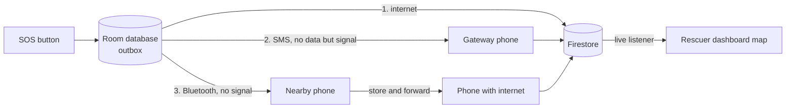

# FloodSOS

**An offline-first flood rescue app for Android.** One tap sends your GPS location and a short note to rescuers, even when mobile internet is down.

During the 2015 and 2023 Chennai floods, mobile data failed for days. People trapped at home had no way to tell rescuers where they were. FloodSOS gets the message out through whichever channel still works.

## How it works

Every SOS is saved on the phone first, then delivered through three fallback levels:



| Level | When | How |
|---|---|---|
| 1. Internet | Data works | Direct upload to Firebase Firestore |
| 2. SMS | No data, some signal | A one-SMS message (`SOS\|lat\|lng\|note\|id\|sender\|time`) goes to a gateway phone, which uploads it |
| 3. Bluetooth relay | No signal at all | Phones pass messages to each other with Google Nearby Connections. Any phone that later gets internet uploads everything it carries. |

Rescuers see live pins on a web map: red for SOS, green for "I'm safe".

## Features

- **Big SOS / "I'm safe" buttons** with GPS location (works without internet) and a short note
- **Offline-first outbox:** messages are stored in Room before any network attempt and are never lost
- **Automatic escalation:** internet first; SMS immediately if offline, or after 30 s if the upload is stuck
- **Phone-to-phone relay** over Bluetooth/Wi-Fi with a 5-hop limit and deduplication
- **Background relay service** with battery-aware duty cycling and randomized timing
- **Auto-upload** the moment the internet comes back
- **Gateway mode:** any phone with internet can receive SOS SMS and forward them
- **Live dashboard** (Leaflet + Firestore real-time listener) on Firebase Hosting
- **Field-test tooling:** an in-app stats screen with JSON export, and a Python script that reports delivery rate, latency percentiles per channel and hop distribution

## Design highlights

- **Idempotent delivery.** Each message has a client-generated UUID that is also its Firestore document ID. Internet, SMS and relay can all deliver the same message, and it is stored once. Uploads are at-least-once, and the UUID makes duplicates harmless.
- **First write wins.** Uploads use a create-only transaction, so a late relayed copy cannot overwrite the original arrival time.
- **One outbox.** Room is the single source of truth. Firestore's own offline write queue is avoided on purpose, so there's one place that says what's been delivered.
- **Compact SMS.** UUIDs are packed from 36 to 22 characters, so the worst case is 147 GSM-7 characters and fits in one SMS.
- **Epidemic routing with a hop limit.** On meeting another phone, a phone sends every message with `hops < 5`, SOS first and oldest first. Duplicates are dropped atomically by the database primary key.
- **Jittered duty cycle.** Two phones with identical scan periods can stay out of phase forever and never meet. Random jitter fixes this; a unit-test simulation demonstrates it.
- **Security rules as the backend.** There is no custom server. Firestore rules validate the schema, ranges and immutability, and require a server-side timestamp.
- **Testable core.** All relay logic (dedup, hop limit, send priority, codecs, duty cycle) lives in pure Kotlin with no Android dependencies.

Deliberately not used: CRDTs, custom crypto, Bloom filters and custom routing algorithms. Keeping it simple was a design goal.

## Tech stack

| Area | Technology |
|---|---|
| Android | Kotlin, Jetpack Compose, Room, WorkManager, foreground service |
| Location | Google Play Services Fused Location |
| Relay | Google Nearby Connections (`P2P_CLUSTER`) |
| Serialization | kotlinx.serialization (versioned wire format) |
| Backend | Firebase Firestore (no custom server) |
| Dashboard | HTML + Leaflet.js on Firebase Hosting |
| Analysis | Python 3 (standard library; matplotlib for charts) |

## Project structure

```
app/src/main/java/com/floodsos/
├── core/          Pure Kotlin (no Android): message model, relay engine, SMS + relay codecs,
│                  duty cycle, peer cooldown, upload payload
├── data/          Room database, DAO, repository, Firestore uploader
├── upload/        WorkManager upload job
├── sms/           SMS sender, SMS fallback job, gateway receiver
├── nearby/        Nearby Connections relay, permission helper
├── relay/         Foreground relay service (duty cycling)
├── location/      GPS provider
└── ui/            Compose screens (SOS, field-test stats) + ViewModels
dashboard/         Rescuer web map (index.html)
tools/             Field-test analysis (analyze.py) and export puller (pull_exports.py)
firestore.rules    Server-side validation
```

## Getting started

### Requirements
- Android Studio, JDK 17
- An Android phone (8.0+) or an emulator with a Google Play image
- A Firebase project (free tier)

### Setup
1. **Firebase project:** in the [Firebase console](https://console.firebase.google.com), create a project and a Firestore database.
2. **Android app config:** add an Android app with package name `com.floodsos`, download `google-services.json`, and place it in `app/`. This file is git-ignored; never commit it.
3. **Deploy rules and dashboard:**
   ```bash
   npm install -g firebase-tools
   firebase login
   firebase use --add
   firebase deploy --only firestore:rules,hosting
   ```
4. **Build and run:** open the project in Android Studio (set the Gradle JDK to 17) and press Run, or run:
   ```bash
   ./gradlew installDebug
   ```

### Running the tests
```bash
./gradlew testDebugUnitTest            # 55 Kotlin unit tests
python -m unittest discover -s tools   # 12 Python tests
```
The Kotlin tests cover the relay engine (including multi-phone simulations), both codecs, the duty cycle, field statistics and the upload payload. The Python tests cover the analysis maths.

## Measuring a field test

1. On each phone, open **Field test stats** and tap **Export**, or connect the phones by USB and run `python tools/pull_exports.py`.
2. Run the analysis for the test window:
   ```bash
   python tools/analyze.py --exports field-data --since 2026-11-30T10:00 --until 2026-11-30T11:00
   ```
3. Read `results/report.md`: delivery rate (exports give the messages *sent*, Firestore the messages *delivered*), latency per channel, hop distribution, Bluetooth exchange stats, and which phones still hold undelivered messages.

Raw exports contain real locations, so `field-data/` is git-ignored.

## Permissions

| Permission | Why |
|---|---|
| Location (fine/coarse) | Your GPS position; also required for Bluetooth scanning |
| Nearby devices (Bluetooth scan/advertise/connect, Wi-Fi) | Phone-to-phone relay (Android 12+) |
| SMS send / receive | SMS fallback / gateway mode |
| Notifications | Shows the relay's foreground-service notification (Android 13+) |

Each permission is requested when its feature is first turned on, not all at startup.

## Testing on real devices

- The Bluetooth relay needs **two or more real phones**; emulators have no Bluetooth.
- SMS can be tested with **two emulators** (they can text each other by port number, e.g. `5554` → `5556`).
- On Xiaomi, Oppo, Vivo, Realme and Samsung phones, set **Battery → Unrestricted** for FloodSOS, or the system may stop the relay. See [dontkillmyapp.com](https://dontkillmyapp.com).

## Status and roadmap

- [x] SOS screen, GPS, local storage
- [x] Firestore upload + live dashboard
- [x] SMS fallback + gateway
- [x] Nearby Connections exchange
- [x] Multi-hop relay, background service, duty cycling, auto-upload
- [x] Field-test stats screen + analysis script (delivery rate, latency, hop distribution)
- [ ] Field test results and full design document

## Known limitations

- **Spoofing:** anyone can send a well-formed fake SOS by SMS or Bluetooth. Messages are validated but not authenticated.
- **Public dashboard:** in this demo the dashboard is readable without sign-in. A real deployment would require rescuer login.
- **Play Store:** SMS permissions are restricted on Google Play, so this build is meant to be installed directly.
- **No restart after reboot:** the relay service doesn't start again after the phone reboots.
